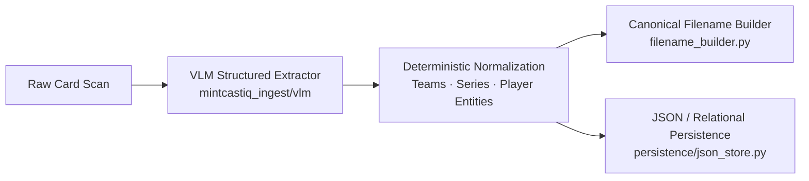

# MintCastIQ — Automated Trading Card Ingestion & Normalization Pipeline

[](https://github.com/mintcastiq/mintcastiq/actions/workflows/ci.yml)


**MintCastIQ** is an end-to-end computer vision and data-engineering pipeline that converts raw scans of sports and trading cards (baseball, basketball, football, Pokémon, and TCG sets) into structured, validated, and canonically named catalog records.

---

## Architecture Overview

MintCastIQ evolved from a multi-stage classical CV/OCR pipeline (`YOLOv8` crop detection + `Tesseract OCR` + `CLIP` zero-shot classifiers, preserved in `mintcastiq_ingest/legacy/`) into a streamlined **Vision-Language Model (VLM) extraction + deterministic normalization** architecture:



### Key Engineering Highlights
* **VLM-First Structured Extraction (`mintcastiq_ingest/vlm/`):** Replaces brittle bounding-box + OCR heuristics with prompt-engineered Vision-Language extraction (`extractor.py`, `prompts.py`, `models.py`) capable of parsing varied card layouts, parallel tiers, and serial numbering.
* **Domain-Specific Entity Normalization (`mintcastiq_ingest/normalization/`):** Standardizes noisy extracted text against curated dictionaries for sports franchises (`teams.py`), TCG expansions (`pokemon_series.py`), and canonical file naming (`filename_builder.py`).
* **Architectural Iteration (`mintcastiq_ingest/legacy/`):** Retains the original `YOLOv8` + `Tesseract` + `CLIP` modular pipeline for benchmarking accuracy and latency against VLM extraction.
* **Automated CI/CD:** Validated on every push via dual **Gitea Actions** (self-hosted homelab runner) and **GitHub Actions** (`ruff` linting + `pytest` test suite).

---

## Project Structure

```text
mintcastiq/
├── mintcastiq_ingest/
│   ├── pipeline/         # End-to-end card ingestion orchestrator (ingest_card.py)
│   ├── vlm/              # Vision-Language Model extraction prompts, models & parser
│   ├── normalization/    # Team, Pokémon series, entity dicts & canonical filename builder
│   ├── persistence/      # Structured JSON storage & catalog serialization
│   ├── legacy/           # Initial YOLOv8 + Tesseract OCR + CLIP classification pipeline
│   └── config.py         # Runtime & model path configuration
├── tests/                # Automated pytest unit & normalization test suite
├── .gitea/workflows/     # Self-hosted Gitea Actions CI pipeline
└── .github/workflows/    # GitHub Actions CI pipeline
```

---

## Quickstart

```bash
# 1. Create and activate a virtual environment
python3 -m venv venv
source venv/bin/activate

# 2. Install dependencies
pip install -r requirements.txt

# 3. Run linter and unit tests
ruff check .
pytest -v --ignore=tests/test_ocr.py
```

---

## Roadmap
- [ ] Expand unit test coverage across `normalization/` edge cases (rookie variants, serial-numbered parallels, multi-player cards).
- [ ] Add `requirements-ci.txt` to cleanly separate CPU ingestion/normalization dependencies from local CUDA inference packages.
- [ ] Wire PostgreSQL upsert adapter alongside `persistence/json_store.py` for downstream market analytics.
